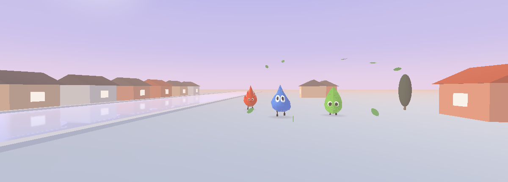
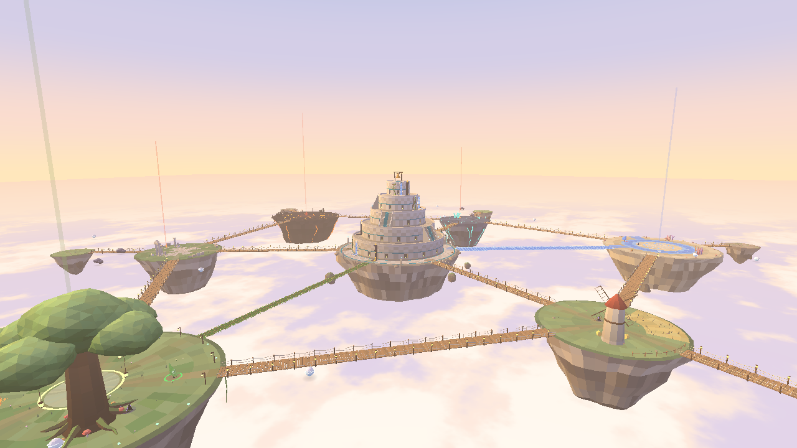

# Elemental Rescue

A playful 3D **rescue adventure** built in [Godot 4.6](https://godotengine.org/),
set in a vast medieval land of rock‑paper‑scissors elementals. Fire, Water and
Leaf each rule a **huge European castle** — curtain wall, towers, gatehouse, a
themed garden courtyard and a great keep with an entrance hall, bedchambers and
portraits of its element on the walls. Your twin is caged in the old dungeon
yard out in the wilds, and **your key is locked in the treasury of the castle of
the element that eats you**: raid it, free your twin, and walk them home to your
keep — while your rival element and the CO₂ roaming the wilderness try to send
you back to the start.



*An actual in‑engine frame — Fire, Water and Leaf strolling the riverbank at dusk.*

## Meet the characters

| | Element | Catches | Flees |
|---|---------|---------|-------|
| 🔥 | **Fire** | Leaf | Water |
| 💧 | **Water** | Fire | Leaf |
| 🍃 | **Leaf** | Water | Fire |

Each character is a textured GLB body with a hand‑rigged pair of stick legs that
swing when walking and stand still when idle.

## How to play

The goal is to **rescue your caged twin** — there is no clock and you can't be
permanently knocked out, so take your time:

1. **Steal your key.** Each element has its own **silvery, colour‑matched key**
   (silvery‑red Fire, silvery‑blue Water, silvery‑green Leaf) — and you can only
   pick up **your own**. It rests on the **treasury dais inside your predator's
   keep**, so claiming it means a raid through their gate, across their garden
   courtyard and into their great hall. Yours is marked in your element's colour
   on the radar; walk over it and it magnets to your back and trails you.
2. **Free your twin.** Carry the key to *your* element's cage in the **dungeon
   yard** out in the wilderness and your twin pops out and starts following you.
3. **Escort them home.** Lead your twin through your gate and into your **keep's
   glowing sanctum** to **win**. If you die mid‑escort they'll wait where they
   are until you come back.

Along the way:

- **Hearts, not lives.** A touch from your predator (the element that beats you) or
  from CO₂ costs **one heart**. At zero hearts you're sent back to your home cave,
  refilled — never eliminated.
- **CO₂ chemistry.** A CO₂ is a carbon with two oxygens. When one **tags you it spends
  an oxygen** and drops to harmless **CO** (it visibly loses an oxygen and greys out on
  the radar). A grey CO can't hurt you — it roams hunting an **O₂ to grab an oxygen** and
  turn back into dangerous CO₂ (or it recharges on its own after a while). O₂ molecules
  respawn, so there's always oxygen in play.
- **Counter‑slow.** Whoever lands a hit on you *or* a clan member is slowed for 5s —
  your window to get away.
- **Your castle is home.** Inside your keep's glowing sanctum you're safe — rivals
  and CO₂ are walled out — but camp too long and you're ejected and locked out for
  a while. Each castle's garden matches its element: an **ember garden** of braziers
  and glowing coals for Fire, **lily ponds and fountains** for Water, and **clipped
  hedgerows and topiary** for Leaf.
- **The home tower (first person!).** A great round tower rises from the middle of
  your keep — and it's your house. Step through its door and the camera drops into
  **your character's eyes** (drag to look around, WASD to walk). A **spiral
  staircase** winds around the glowing light column through six floors: the throne
  hall, a kitchen, a living room, a **music room** (grand piano, cello, violin and
  drifting notes), a bedchamber and a library — small candle-lit windows, rugs,
  fireplaces and portraits of your element all the way up — then opens onto a
  **crenellated roof terrace** with a banner, a brazier and a stargazing scope.
  Two secrets hide inside, Hogwarts-style: a **bookshelf that slides aside** for a
  treasure room (a bonus heart, once per round), and a **portrait concealing a
  ladder** that whisks you straight to the roof. Time at home never counts toward
  the camping eject — stay as long as you like. Walk out the door and the chase
  camera returns. (Single-player for now; online guests keep the classic view.)
- **Self‑training.** Stand on the glowing **totem** in your courtyard (with no enemy
  near) to earn an **extra heart**, up to four. Training is kept even after you're
  sent home.
- **Clan hall.** Stand in your **clan hall** for ~4s to summon a **clan of 10** of
  your own element. The moment they appear the camera lifts into a **top‑down command
  view** (looking down through the see‑through roof) and they gather under it. **Click**
  members to select them (multi‑select — they turn grey), then pick one of three tasks
  from the buttons at the top of the screen (the icons are little renders of the real
  figures). Once every member is assigned (or you walk off), the camera returns to normal:
  - **Protect me** — hunt down your predator and any black CO₂ that threatens you.
  - **Attack** — chase and tag the element you eat.
  - **Fetch key** — find your key and carry it back to you.

  Re‑select any time to re‑assign. (Left‑click selects; left‑*drag* still looks around.)
- **Sip O₂ for sprint.** You don't *need* oxygen to survive — but each white **O₂**
  you walk over **supercharges your sprint**: a bigger effective stamina tank (drains
  slower, refills faster) plus an instant gulp. You're now racing the grey CO for the
  same molecules — the bar stays the same size, it just lasts longer.
- **River & bridges.** The river slows every element except Water; cross on the
  five bridges.
- **The wilds.** All the CO₂ and O₂ roam the **wilderness between the castles** —
  hamlets, rock shelters, woods and the dungeon yard. They never spawn inside a
  curtain wall (though a chasing CO₂ may follow you through your gate).
- **Black stones (Pac‑Man power‑up).** Scattered dark stones (shown on the radar)
  turn you into an **energized black figure** for 15s and run a little faster. While
  disguised the tables turn: your **predator panics and flees, and you can eat it**
  on contact, and the CO₂ treat you as one of their own. The catch — the **O₂ see
  through it and hunt you**, and a bite ends the disguise and costs a heart. Each
  stone reappears elsewhere a while after it's used.

The rival elements, CO₂ and O₂ all run a **context‑steering brain**: chasers aim at
where you're *going* (not where you are) to cut you off, fleers slip toward open
ground instead of trapping themselves in a corner, and the CO₂ pack spreads out to
cover more of the map.

## Skyfall Isles — Ascent

The third world on the intro page is a different game: **floating islands at golden
hour over an endless cloud sea**, and a race called **Ascent** — *light your Spark
from three Sun Motes, climb the Sky Spire, and ring the Sky Bell three times before
anyone else.* No clans, cages, keys or home tower up here.



- **The isles.** Heart Isle carries the Sky Spire. Around it: three home isles
  (Fire's obsidian **Ember Crag**, Water's lagoon **Tide Atoll**, Leaf's **Canopy
  Grove**) each with a safe sanctum, three wild isles (Windmill, Ruin, Crystal) and
  six small islets, joined by plank bridges. Walk off any edge and you fall through
  the clouds, then respawn at home.
- **Each element travels its own way.** Fire's thermal vent flings it straight from
  Ember Crag to Heart Isle. Water surfs the sky stream at double speed (everyone
  else wades it). Leaf walks a private vine — and can stand on a **seed** for 1.5 s
  to grow a vine bridge from the other homes to Heart Isle that anyone may use for
  10 s.
- **Gather.** Three Sun Motes in your colour float on the outer isles; one is
  *always on your prey's home isle*, so everybody has to raid. Touch all three and
  your Spark ignites — motes are never lost to a fall or a knockout.
- **Climb.** The spire door opens only for a lit Spark. Five ring terraces, 6 m
  apart; one stair per tier, each 72° further round than the last. Opposite every
  stair are three shortcut pads — a Fire vent, a Water lift, a Leaf vine — and
  yours carries you up a tier (4 s recharge). Catches only happen between actors on
  the same tier, and a tag on the spire costs a heart **and a tier**.
- **Ring.** Stand in the glowing ring on the top platform for 2 s to ring the bell.
  It swings for 4 s after any ring. First to three rings wins; at 8:00 the highest
  Spark wins.
- **The Eclipse.** Every 75 s the food chain **reverses** for 15 s: your predator
  becomes your prey. The rim glow under each rival (red = it eats you, green = you
  eat it) flips with it.
- **The smog sea.** Every minute the cloud sea rises and swallows a ring of the map
  (outer islets, then the homes, then the wild isles). Swallowed ground slows you
  and costs a heart every 2 s.
- **Shoves.** Up here a predator's touch also shoves you 6 m — near an edge, that
  is a long way down. CO₂ drifts as smog clouds, O₂ as breeze bubbles, and the
  black stones are Meteor Shards.

**The whole world is modelled in Blender.** `tools/blender/build_sky_assets.py`
builds every asset procedurally (headless `bpy`) and exports one GLB each to
`models/sky/`; `tools/blender/assemble_world.py` places them into one scene, saved
as `tools/blender/skyfall_isles.blend` and exported as the single file the game
loads, `models/sky/skyfall_world.glb`. To rebuild:

```sh
uv venv -p 3.11 ~/bpy-venv && uv pip install -p ~/bpy-venv/bin/python bpy numpy
~/bpy-venv/bin/python tools/blender/build_sky_assets.py     # every asset GLB (+ previews)
~/bpy-venv/bin/python tools/blender/assemble_world.py       # skyfall_world.glb + the .blend
godot --headless --path . --import
```

## Controls

| Action | Input |
|--------|-------|
| Move | `W` `A` `S` `D` or arrow keys |
| Sprint | hold `Shift` (drains stamina) |
| Look around | drag with the **left mouse button** |

## Running it

Open the project folder in **Godot 4.6+** and press play, or from the command line:

```sh
godot --path .
```

To jump straight into a round (skipping the menu) for quick testing:

```sh
godot --path . -- autostart           # play as Fire
godot --path . -- autostart water     # play as Water
godot --path . -- autostart grass     # play as Leaf
godot --path . -- autostart fire sky  # straight into an Ascent round on the Skyfall Isles
```

Hands-off Ascent QA: add `autopilot autoquit` to let the rival AI drive your avatar
too, and `--headless --fixed-fps 20` to fast-forward a whole round in seconds.

## Under the hood

The code lives in `src/`, the scenes in `scenes/` (`main.tscn` is the entry
point), and the imported art in `models/`; `project.godot` and `icon.svg` stay at
the project root where Godot expects them.

Everything in the castle and town worlds except the three elemental bodies is built
procedurally in code (`src/mesh_lib.gd`) — castles, houses, props, the gas molecules, caves and the
storybook materials — so the project stays self‑contained. The fire/water/leaf bodies are
imported GLB meshes (`models/Fire3.glb`, `models/Water3.glb`, `models/Leaf3.glb`); their legs are
generated at load time and auto‑seated into each body so they always connect
cleanly regardless of body shape.

Key scripts (under `src/`):

- `game.gd` — the main game loop, AI, castles/caves, river, scoring and camera.
- `game_char.gd` — per-actor state (the `GameChar` class: position, hearts, role).
- `mesh_lib.gd` — procedural mesh/material factory and the character builders.
- `char_visual.gd` — the walking rig (body bob + leg/arm swing).
- `world_builder.gd` — lays out the three castles (walls, gardens, keeps,
  home towers, portraits, beds), the dungeon yard, hamlets and river.
- `ui.gd` / `radar.gd` — HUD, scoreboard and minimap.
- `sky_layout.gd` — the Skyfall Isles map as pure data: isles, bridges, element
  routes, the spire's tiers / stairs / pads, the walkable test and the nav graph.
- `sky_builder.gd` — loads the Blender-authored world (`models/sky/skyfall_world.glb`),
  reads its `col_*` helpers, adds the cloud-sea / smog shaders and golden-hour sky.
- `sky_view.gd` — what moves up there: motes, Spark orbs, the bell, seed vines, the
  smog front, the eclipse tint.
- `mode_ascent.gd` — every Skyfall / Ascent rule (eclipse, shove, falling, motes,
  the tier layer, pads, bell, smog sea, win), the rival AI and the online mirror.

It began life as a Three.js prototype (`elemental-tag.html`) and was ported to
Godot.
